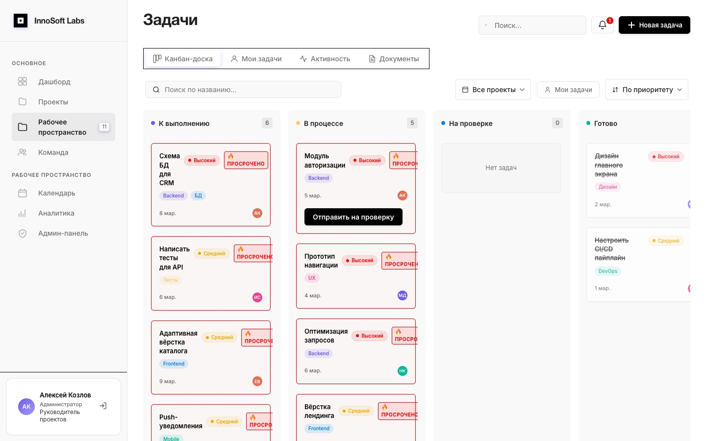
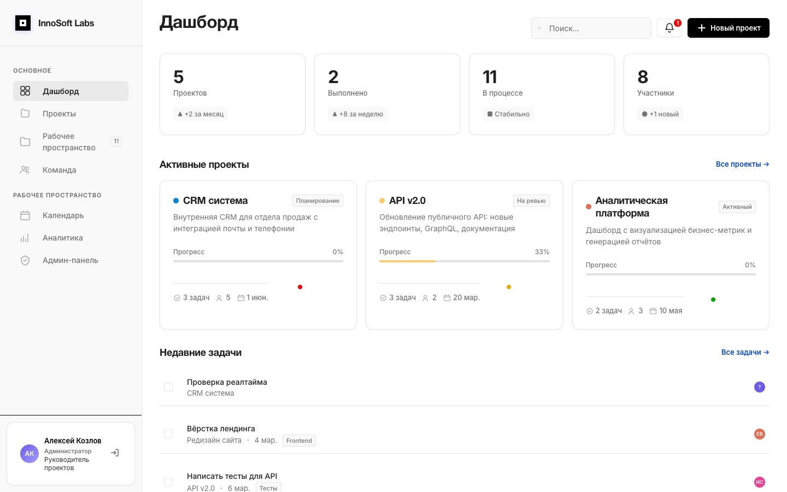
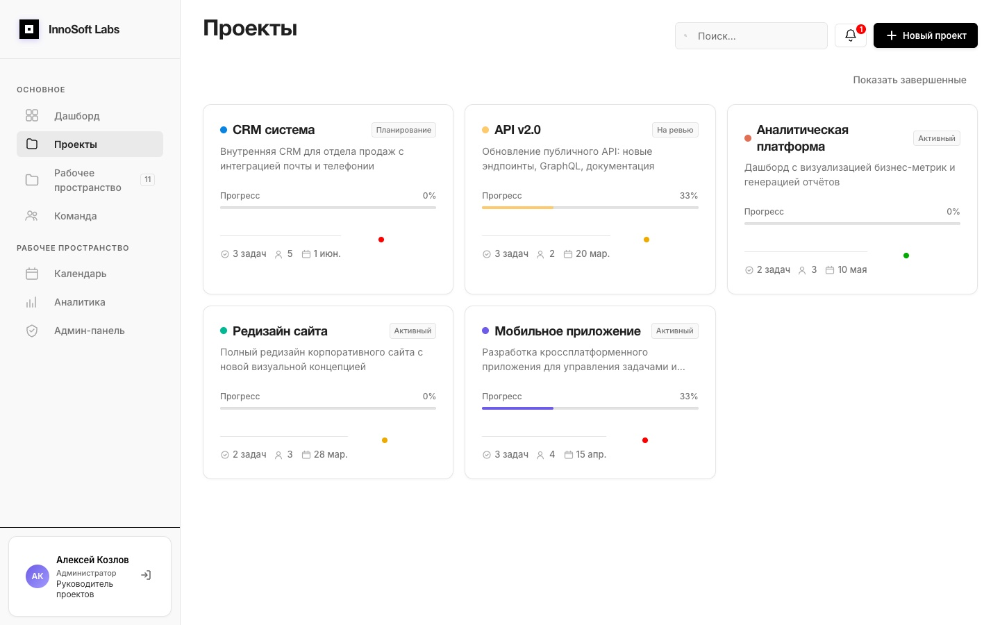

# InnoSoft Labs

Таск-трекер для небольшой команды: проекты, канбан-доска, проверка задач менеджером,
вход только по приглашению. Изменения задач приходят всем участникам проекта
в реальном времени.



## Зачем

<!-- ✍️ ТВОЙ ТЕКСТ. 3–5 предложений: для кого делал, какую задачу решал,
     почему не взять готовый трекер. Удали этот комментарий, когда напишешь. -->

## Что умеет

**Роли.** Администратор создаёт проекты и приглашает менеджеров. Менеджер ведёт свои проекты:
приглашает участников, ставит задачи с ТЗ и вложениями, принимает или возвращает работу.
Участник работает со своими задачами. Наблюдатель только смотрит.

**Задачи** идут по циклу `todo → in_progress → pending_review → done`. Закрыть задачу сам
участник не может — только отправить на проверку; менеджер принимает её или возвращает
с комментарием, исполнителю приходит уведомление.

**Приглашения** — одноразовые или многоразовые ссылки с ролью и сроком действия. По ссылке
новый человек регистрируется и сразу попадает в проект.

**Ещё:** комментарии и файлы в задачах, документы проекта по папкам, лента активности,
календарь дедлайнов, аналитика по проектам и команде для менеджеров.

| | |
|---|---|
|  |  |
| Дашборд | Проекты |

## Как устроено

```
Браузер (React + Zustand) ──HTTP /api──▶ FastAPI ──▶ MySQL 8   (данные, Alembic)
        ▲                                   │  ├───▶ Redis 7   (кэш аналитики, 5 мин)
        └──────── Socket.IO ◀───────────────┘  └───▶ MinIO     (вложения, аватары)
```

- **Backend** полностью асинхронный: FastAPI, SQLAlchemy 2 + aiomysql.
- **Права** проверяются на каждом запросе по роли в конкретном проекте (`app/core/permissions.py`).
- **Реалтайм:** при подключении к Socket.IO сервер проверяет JWT и сам подписывает сокет
  на комнаты пользователя и его проектов. События по задачам уходят только участникам проекта.
- **Аналитика** считается SQL-запросами и кэшируется в Redis; любое изменение задач сбрасывает кэш.
- **Файлы** лежат в MinIO (S3-совместимое хранилище), наружу отдаются по подписанным ссылкам.

## Что было сложно

<!-- ✍️ ТВОЙ ТЕКСТ. 2–4 пункта: проблема → как решил. Например (если правда было):
     - роли на двух уровнях: системная роль и роль в проекте;
     - цикл проверки задач, чтобы участник не мог закрыть задачу сам;
     - реалтайм через Socket.IO поверх FastAPI;
     - приглашения: одноразовые/многоразовые, срок, привязка к нескольким проектам.
     Удали этот комментарий, когда напишешь. -->

## Стек

**Backend:** Python 3.12, FastAPI, SQLAlchemy 2 (async), Alembic, MySQL 8, Redis, MinIO, python-socketio, JWT
**Frontend:** React 19, TypeScript, Vite, Zustand, Socket.IO
**Инфраструктура:** Docker Compose, GitHub Actions

## Запуск

```bash
cp .env.docker.example .env     # вписать JWT_SECRET_KEY: openssl rand -hex 32
docker compose up --build       # http://localhost:8000
```

Поднимутся MySQL, Redis, MinIO и приложение; схема БД создаётся миграциями.
С демо-данными (`SEED_DEMO=true`, по умолчанию в compose) можно войти как
`a.kozlov@innosoft.dev` / `password123` (администратор). Если порты 8000 или 9000 заняты:
`APP_PORT=8080 MINIO_PORT=19000 docker compose up`.

<details>
<summary>Локальная разработка</summary>

```bash
cd backend
python3.12 -m venv .venv && source .venv/bin/activate
pip install -r requirements-dev.txt
cp .env.example .env                     # вписать JWT_SECRET_KEY и адреса MySQL/Redis/MinIO
alembic upgrade head
uvicorn app.main:app --reload            # http://localhost:8000/docs

cd ../frontend && npm install && npm run dev   # http://localhost:5173
```

В Docker Compose MySQL и Redis наружу не проброшены. Для локальной разработки
поднимите свои инстансы или добавьте им `ports` в `docker-compose.yml`.
База, созданная старой версией без Alembic, переводится на миграции командой
`alembic stamp head`.
</details>

## Тесты

```bash
cd backend && pip install -r requirements-dev.txt && pytest
```

43 теста: авторизация, права по ролям, цикл проверки задач, приглашения, доступ
к чужим проектам, комментариям и вложениям, Socket.IO, раздача статики.
Тесты идут на SQLite в памяти, Redis и MinIO подменяются.

## Что дальше

<!-- ✍️ ТВОЙ ТЕКСТ (по желанию). Честные ограничения, которые я видел:
     - бакет MinIO открыт на чтение всем — ссылки не угадать (uuid), но правильнее
       закрыть его и отдавать только подписанные ссылки;
     - линтер фронта: ~60 мест с any, их стоит типизировать;
     - в аналитике не рисуются столбцы графика «Задачи по проектам»;
     - при добавлении в новый проект события по нему приходят после переподключения.
     Удали этот комментарий, когда напишешь. -->

---

Проект сделан весной 2026 года. В git перенесён после разработки — история начинается
одним коммитом, дальше идут доработки. Ранний прототип на vanilla JS в репозиторий не входит.
